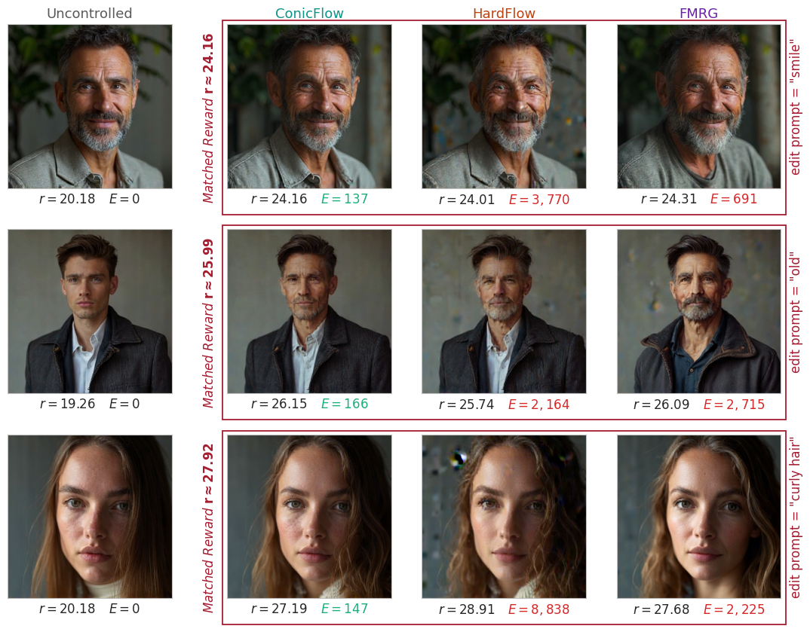
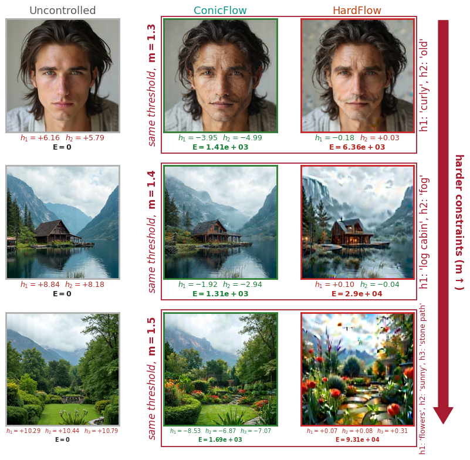

# ConicFlow: Constrained Inference-time Optimal Control for Flow Matching Models

**Shervin Khalafi\*, Kasra Fallah\*, Sung Cho, Dongsheng Ding, James Anderson, Alejandro Ribeiro**
<sub>\* equal contribution</sub>

[[Paper]](https://arxiv.org/abs/XXXX.XXXXX) <!-- TODO: arXiv ID -->

ConicFlow steers a pretrained flow matching model at inference time by solving
an optimal control problem: stay close to the pretrained trajectory, increase a
terminal reward, and satisfy hard terminal constraints. The problem is
discretized and solved with receding-horizon control, so each sampling step
only optimizes a short window of the trajectory. A primal–dual update carries
one multiplier per constraint through sampling, which steers the trajectory
toward feasible samples. No retraining is involved.

This repository contains the code for every experiment in the paper: a
two-dimensional flow map (two moons), and FLUX.1-dev image editing, both
unconstrained and under one to three PickScore constraints. ConicFlow is
compared against [FMRG](https://github.com/jrrhuang/fmrg) and
[HardFlow](https://github.com/azizanlab/HardFlow).

<p align="center">
  
  
</p>
<p align="center"><sub>
<b>Left:</b> reward-guided edits at matched reward. ConicFlow reaches the same reward with far less control energy E.
<b>Right:</b> one to three PickScore constraints as the threshold multiplier m increases. Both methods are held to the same feasible set.
</sub></p>

---

## Contents

- [Repository layout](#repository-layout)
- [Installation](#installation)
- [Quickstart](#quickstart)
- [Reproducing the paper](#reproducing-the-paper)
- [Methods and options](#methods-and-options)
- [Practical notes](#practical-notes)
- [Citation](#citation)
- [Acknowledgements and third-party code](#acknowledgements-and-third-party-code)

## Repository layout

```
lowdim/                      two-moons experiment (Figure 1), CPU; checkpoint and sweep CSVs included
image/
  src/                       FLUX experiments; run everything from here
    run_sweep.py             the driver: builds configs, runs them, writes summary.csv + images
    control_loops.py         ConicFlow's receding-horizon solver and the HardFlow port
    image_conicflow.py       FLUX flow-map wrappers, the FMRG baseline, trajectory rewards
    compare_constrained.py   one constrained instance: probe -> thresholds -> ConicFlow, HardFlow
    lambda_autorange.py      finds the lambda range where control has an effect (optional)
    ...                      reward normalization, plotting, diagnostics
  scripts/
    unconstrained/           Table 1, Figure 2, appendix frontiers   (run_table1.sh)
    constrained/             Figure 3, appendix constrained grids     (run_suite.sh)
    ablation/                appendix ablations                       (run_ablation.sh)
  analysis/                  turns results into the paper's tables and figures (CPU)
  data/grids/                the frozen lambda grids the paper's runs used
  docs/                      hyperparameter rationale; how the lambda range finder works
fmrg/                        FMRG (Apache-2.0), vendored with local changes (fmrg/MODIFICATIONS.md)
flow-maps/                   flow-map training code (MIT), used to train the two-moons model
scripts/                     environment post-install helpers
```

## Installation

**Hardware.** The image experiments need one NVIDIA GPU with 24 GB per
process; the paper used RTX A5000s. The two-moons experiment runs on CPU.

**Environment.** The tested route is [uv](https://docs.astral.sh/uv/), whose
lockfile pins every package (Python 3.10, PyTorch 2.5.1 + CUDA 12.1):

```bash
git clone https://github.com/shervinkhalafi/conicflow.git
cd conicflow
uv sync --locked
bash scripts/uv_postinstall.sh    # fixes a missing hpsv2 file and prints a version check
source .venv/bin/activate
```

`environment.yml` describes the conda environment the paper's runs were made
in. It also contains the JAX training stack for `flow-maps/`, which conflicts
with PyTorch's cuDNN pin (see the comments in that file), so prefer uv.

**Model weights.** FLUX.1-dev is gated on Hugging Face. Accept its licence at
<https://huggingface.co/black-forest-labs/FLUX.1-dev>, then log in, and fetch
the FlowMap LoRA released with FMRG:

```bash
huggingface-cli login                  # or: export HF_TOKEN=hf_...
export HF_HUB_DISABLE_XET=1            # recommended
(cd fmrg && bash checkpoints_download.sh)
```

This downloads the LoRA (~1.1 GB) into `fmrg/checkpoints/` and FLUX.1-dev
(~32 GB) into `$HF_HOME` (default `~/.cache/huggingface`). The reward models
(PickScore, CLIP-ViT-H-14, ImageReward) download on first use.

**Check it.** `cd image/src && python run_sweep.py --help` should print the
full option list.

## Quickstart

One ConicFlow edit at the paper's settings. It takes about 4 minutes on an
A5000, model loading included:

```bash
cd image/src
python run_sweep.py \
    --sweep_prompt "a portrait of a young man" \
    --sweep_edit_prompt "a portrait of an old man" \
    --reward pickscore \
    --sweep_control_type conicflow --sweep_N 8 --sweep_H 2 \
    --sweep_n_inner 24 --sweep_lr_inner 1e-2 \
    --sweep_endpoint_surrogate jump \
    --sweep_lam 10.0 \
    --flux_device cuda:0 --reward_device cuda:0 \
    --seed 317 --out_dir results/quickstart
```

The output directory holds the uncontrolled and controlled images and a
`summary.csv` row with the reward gain (`delta_r`), the control energy, and
the full configuration. Use `--sweep_control_type hardflow` or `fmrg` to run a
baseline. Every `--sweep_*` flag takes a list, and the runs are their
cartesian product. A constrained example:

```bash
python compare_constrained.py \
    --prompt "a portrait of a man" --edit_prompt "a smiling face" \
    --constraint_types pickscore --constraint_args "a smiling face" --constraint_directions ge \
    --auto_threshold --auto_lo 1.3 --auto_hi 1.3 --n_grid 1 \
    --lam 20 --seed 310 --gpu 0 --out_dir results/quickstart_constrained
```

This draws the uncontrolled sample and sets the threshold to 1.3× its
PickScore. It then runs ConicFlow and HardFlow under that constraint and writes
an `uncontrolled | ConicFlow | HardFlow` comparison figure.

## Reproducing the paper

Every experiment has a launcher that runs the paper's exact configurations on
the frozen λ grids in `image/data/grids/`, and analysis scripts that turn the
results into the paper's tables and figures. Launchers take the GPU index as
their first argument. They run one process per card, resume where they
stopped, and accept `--dry_run` to print their commands.

| Paper | Run | Cost | Analysis (`image/analysis/`) |
|---|---|---|---|
| Fig. 1 (two moons) | [`lowdim/reproduce_fig1.sh`](lowdim/README.md) | CPU, ~3 h (or seconds, from the shipped sweep CSVs) | `lowdim/make_fig1.py` |
| Table 1, Fig. 2 (left), appendix frontiers, appendix rows u05–u10 | [`image/scripts/unconstrained/run_table1.sh`](image/scripts/unconstrained/README.md) | ~26 GPU-h | `table1_breakdown.py`, `fig2_pareto.py`, `fig2_image_rows.py` |
| Fig. 2 (right) rows 2–3, appendix rows u01–u04 | [`image/scripts/ablation/run_ablation.sh`](image/scripts/ablation/README.md) `--arms core --tags "ed1 ed2 ed3 ed4" --seeds "317 1289"` | ~5 GPU-h | `fig2_image_rows.py` |
| Fig. 3, appendix constrained grids | [`image/scripts/constrained/run_suite.sh`](image/scripts/constrained/README.md) (`suite`, then `triple`) | ~12 GPU-h | `../src/plot_constrained_suite.py`, `constrained_image_rows.py`, `constrained_appendix_grids.py` |
| Appendix ablations: horizon, matched wall clock, evaluation point | [`image/scripts/ablation/run_ablation.sh`](image/scripts/ablation/README.md) | ~130 GPU-h in total | `abl_figs.py` |

GPU-hours are on one RTX A5000 per process, model loads included. The README
in each directory gives the design, the exact settings, and partial-run options
(e.g. one reward, one horizon, or a subset of seeds).

```bash
cd lowdim
python make_fig1.py                          # Fig. 1 from the shipped sweep CSVs
bash reproduce_fig1.sh                       # ... or re-run the sweeps first (CPU)

cd ../image/scripts
bash unconstrained/run_table1.sh 0           # Table 1 / Fig. 2 (left)
bash constrained/run_suite.sh 1              # Fig. 3 (8 instances x 2 seeds x 5 thresholds)
bash constrained/run_suite.sh 1 triple       # the three-constraint instance
bash ablation/run_ablation.sh 0              # appendix ablations (or --arms core for Fig. 2 right)

cd ../analysis
python table1_breakdown.py
python fig2_pareto.py
python fig2_image_rows.py
python constrained_image_rows.py
python constrained_appendix_grids.py
python abl_figs.py --out figs/ablation
```

**What to expect.** The analysis scripts were checked against the paper's own
runs. On that data they reproduce Table 1, the per-problem breakdown, Figure 3's
medians and feasibility counts, and the ablation tables, with one exception:
four bootstrap-interval endpoints in the ablation tables differ by 0.01
because of cell ordering. The image figures come out byte-identical to the
originals, and so do Figure 1's two frontier panels when drawn from the
shipped CSVs. A fresh run reproduces the results
statistically rather than digit for digit:

- **Uncontrolled samples are deterministic for a given seed.** A fresh clone in
  the uv environment reproduced the paper's uncontrolled rewards and
  constraint thresholds bit for bit.
- **Controlled runs are not bitwise reproducible on GPU.** Re-running one
  ablation cell (edit ed1, seed 317):
  - ConicFlow at λ = 5.9 gave reward 25.04 vs the paper's 25.11, with energy
    within 3%.
  - FMRG and HardFlow, over all six λ, gave rewards within 0.6 of the paper's.
    Their control energies were within 0.6–1.1× of the paper's, except at
    FMRG's largest λ, where it was 2.4× lower.
- **Feasibility can flip near a constraint boundary.** Three runs of one
  constrained ConicFlow config (p01_smile, seed 310, m = 1.5) gave
  h = −3.56, −0.28 and +0.58, with energy within 5%. Figure 3 pools 16
  problems per m, so expect its feasibility counts to move by a run or two.

## Methods and options

| | `--sweep_control_type` | main knobs | cost in `N` |
|---|---|---|---|
| **ConicFlow** (ours) | `conicflow` | `N`, `H`, `n_inner`, `lr_inner`, `lam`, `endpoint_surrogate` | the inner loop differentiates through the terminal estimate: linear in `N` with `endpoint_surrogate=jump`, quadratic with `rollout` |
| **HardFlow** | `hardflow` | `N`, `n_inner`, `lr_inner`, `hardflow_reg` | optimizes the predicted terminal latent and never differentiates the transformer; linear in `N` |
| **FMRG** | `fmrg` | `N`, `n_inner` (guidance steps), `lam` | open loop: `z ← z + (dt/n_inner)·lam·∇r(X(z))` |

**`lam` does not mean the same thing in all three.** For ConicFlow it weights
the objective `J = energy/(2·lam) − r`. For HardFlow the same physical quantity
enters as `hardflow_reg = N/(2·lam)`, which `run_sweep.py` derives per run when
`--sweep_hardflow_reg` is omitted. For FMRG it is an open-loop gain on the
reward gradient. Larger `lam` means more control in all three. That makes a
shared grid a reasonable axis to sweep, but not a fair one to compare on. The
paper therefore compares reward-vs-energy frontiers, which don't depend on what
each knob means.

**Constraints** (ConicFlow and HardFlow only) are given to `run_sweep.py` as
`--constraint_types`, `--constraint_args`, `--constraint_thresholds` and
`--constraint_directions`, one entry per constraint. The direction is always explicit; it is never inferred
from the reward. `--reward none` makes the objective control energy alone.

**Locked defaults.** `constraint_on=endpoint` and `warmstart=True` are asserted
at the start of every run. To vary one, set `FLOWMAPS_UNLOCK=<field>` for that
invocation. The run then prints a banner and records `unlocked=<field>` in its
CSV row. The evaluation-point ablation is the only experiment that does this.

`python run_sweep.py --help` lists every option with worked examples, and
`image/docs/HYPERPARAMETERS.md` explains why each setting is what it is.

## Practical notes

- **Pin one GPU per process.** Pass the same device to `--flux_device` and
  `--reward_device`. On some multi-GPU machines, a cross-device tensor copy can
  silently return zeros and corrupt the reward with no error, so
  `--reward_device auto` is not safe. The launchers pin `CUDA_VISIBLE_DEVICES`
  for this reason.
- **Memory.** The FLUX transformer is int8-quantized by default (12.3 GB).
  Unconstrained runs peak at 15–19 GB. Constrained runs peak at 16.2, 19.2 and
  22.2 GB with one, two and three constraints. `--quantize none` does not fit
  in 24 GB.
- **Never use `--quantize nf4` with a gradient-based method.** The forward pass
  is correct, but input gradients come back as almost zero. ConicFlow and
  HardFlow then seem to run normally while steering nothing.
- **`--reward_dtype fp32`** (the default) matches every reported result.
  `fp16` saves memory but changes the reward values.
- **Failures are never dropped silently.** A failed or non-finite run gets
  `run_ok=False` and a `FAILED_`-prefixed directory. `--resume` retries those
  and skips rows that already succeeded.
- **Energy units.** `summary.csv` stores `ctrl_energy` as the displacement
  residual `Σ‖Δx_k‖²·dt`. The paper reports `E = Σ‖u_k‖²·dt` with
  `u_k = Δx_k/dt`, which is the same number times `N²`. The analysis scripts
  apply this conversion per row.

## Citation

```bibtex
@article{khalafi2026conicflow,
  title   = {ConicFlow: Constrained Inference-time Optimal Control for Flow Matching Models},
  author  = {Khalafi, Shervin and Fallah, Kasra and Cho, Sung and Ding, Dongsheng and Anderson, James and Ribeiro, Alejandro},
  journal = {arXiv preprint arXiv:XXXX.XXXXX},
  year    = {2026}
}
```

## Acknowledgements and third-party code

- **FMRG** ([jrrhuang/fmrg](https://github.com/jrrhuang/fmrg), Apache-2.0)
  supplies the FLUX.1-dev FlowMap sampler, the reward-model wrappers, and the
  FMRG baseline. It is vendored in `fmrg/` with local changes, which are listed
  in `fmrg/MODIFICATIONS.md`.
- **HardFlow** ([azizanlab/HardFlow](https://github.com/azizanlab/HardFlow)) is
  ported to FLUX latents in `image/src/control_loops.py` (`hardflow_image`). That
  function's docstring records the deliberate deviations from the released
  implementation.
- **Flow maps** ([nmboffi/flow-maps](https://github.com/nmboffi/flow-maps), MIT)
  is vendored in `flow-maps/` and was used to train the two-moons flow map.
- **FLUX.1-dev** is by Black Forest Labs and is distributed under its own
  non-commercial licence.
